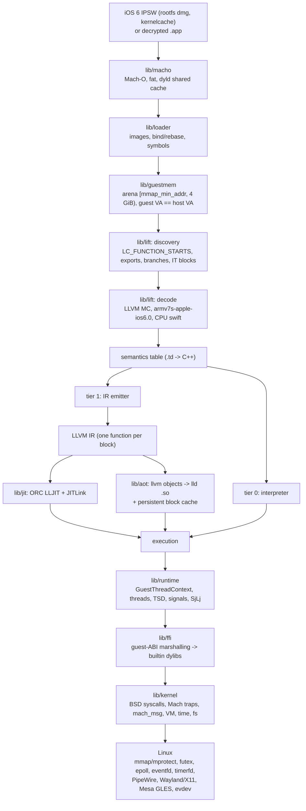
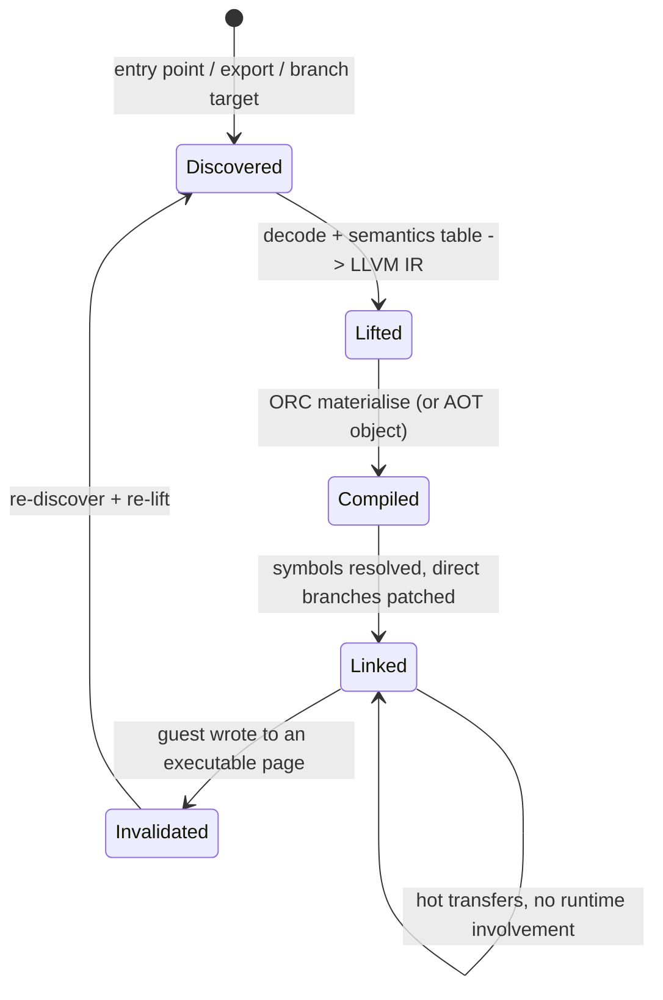

# 01 — Architecture

Read [02-decisions.md](02-decisions.md) first: this document is the *shape* that those decisions
imply, not a re-justification of them.

## Pipeline



Two flows matter and only two: **cold** (a guest VA with no translated block yet → discovery →
lift → IR → compile → execute) and **hot** (a direct transfer between two already-linked blocks,
with no runtime involvement at all).

## Components

Every component below gets its own directory and its own header directory. The `Interface` column
names the *only* header other components may include from it; anything else inside the directory is
private, and the build enforces this (see `10-build-tooling.md`).

| Component | Directory | Interface | Responsibility |
|---|---|---|---|
| `macho` | `lib/macho/` | `ios6/macho/image.hpp`, `ios6/macho/cache.hpp` | Mach-O 32-bit and fat parsing, load commands incl. `LC_REEXPORT_DYLIB`/`LC_LOAD_WEAK_DYLIB`/`LC_SUB_*`, export trie, `__LINKEDIT` decoding, dyld-212 shared cache parsing (88-byte header, no subcaches, local symbols), `.tbd` emission for stubs. |
| `loader` | `lib/loader/` | `ios6/loader/loader.hpp` | Choose builtin/guest/stub per install name, map images into the arena, apply rebases and binds, resolve symbols (with a real 2-level namespace per image), build the ObjC/dyld metadata the guest expects, refuse encrypted images. |
| `abi` | header-only | `ios6/abi/*.hpp` | `guest_addr_t`, `g_ptr<T>`, explicit-width ILP32 structs with `static_assert`s ([ADR-03](02-decisions.md)); included by every component, depends on nothing. |
| `guestmem` | `lib/guestmem/` | `ios6/guestmem/arena.hpp` | The low arena `[mmap_min_addr, 4 GiB)` (64 KiB..4 GiB on this host, [ADR-02](02-decisions.md)): reserve, map, protect, and the `guest_addr_t ⇄ void*` conversions. Also the guest heap allocator used by builtins. |
| `guestcode` | `lib/guestcode/` | `ios6/guestcode/table.hpp` | Guest VA → block address resolution and lazy materialisation ([ADR-04](02-decisions.md) shadow region or its fallback), block metadata (length, thumb bit, IT context), invalidation on `mprotect`/write. |
| `lift` | `lib/lift/` | `ios6/lift/lift.hpp` | Decoding, block discovery, the semantic table, IR emission, and the interpreter. |
| `jit` | `lib/jit/` | `ios6/jit/jit.hpp` | ORC/LLJIT setup, the custom `JITLinkMemoryManager` for the shadow region, symbol naming, relinking on invalidation. |
| `aot` | `lib/aot/` | `ios6/aot/aot.hpp` | The offline half of the same pipeline: emit objects, drive `lld`, serialise the block cache. |
| `runtime` | `lib/runtime/` | `ios6/runtime/thread.hpp` | `GuestThreadContext`, guest threads and stacks, TSD via `TPIDRURO` (no `__thread`/TLV on iOS 6), signal delivery, SjLj landing-pad support, the `call_guest` trampoline. |
| `ffi` | `lib/ffi/` | `ios6/ffi/bridge.hpp` | Guest-ABI marshalling stubs generated from `builtins/*.td`, plus the dynamic-symbol registry that makes (stub) mode possible. |
| `kernel` | `lib/kernel/` | `ios6/kernel/` | The substituted kernel: BSD syscalls, Mach traps, `mach_msg` and ports, VM, timebases, filesystem namespace, IOKit facade, `libkern`. |
| `builtins` | `lib/builtins/<image>/` | `ios6/builtins/` | Native implementations of substituted dylibs, one directory per image (`libdyld/`, `OpenGLES/`, `UIKit/`, `IOSurface/`, …). |
| `media` | `lib/media/` | `ios6/media/` | GLES/EGL, `IOSurface`, compositor, audio, input. |
| `tools` | `tools/` | — | The `ios6recomp` CLI (see `10-build-tooling.md`). |

Dependency rule: `kernel` and `builtins` may depend on `runtime`/`ffi`/`guestmem`; **nothing** in
`lift`/`jit`/`aot` may depend on `kernel`/`builtins`, so the translator can be tested with a
zero-runtime harness (`12-testing.md`). `runtime` must not depend on `lift`.

## Address space

```svg
<svg viewBox="0 0 1040 540" font-family="ui-monospace,monospace" font-size="12" fill="currentColor">
  <defs>
    <marker id="ar" markerWidth="8" markerHeight="8" refX="6" refY="3" orient="auto">
      <path d="M0,0 L6,3 L0,6" fill="none" stroke="currentColor"/>
    </marker>
  </defs>

  <rect x="40" y="40" width="340" height="440" fill="none" stroke="var(--border)"/>
  <text x="52" y="60" font-weight="bold">Guest space: low 4 GiB, identity-mapped</text>

  <rect x="56" y="72" width="308" height="34" fill="none" stroke="var(--border)" stroke-dasharray="2 3"/>
  <text x="64" y="93">[0, M) __PAGEZERO, kernel-unmappable</text>

  <rect x="56" y="112" width="308" height="34" fill="none" stroke="var(--border)"/>
  <text x="64" y="133">arena [M, 4 GiB), PROT_NONE</text>

  <rect x="56" y="152" width="308" height="30" fill="none" stroke="var(--border)"/>
  <text x="64" y="172">app image (slid if MH_PIE)</text>

  <rect x="56" y="188" width="308" height="30" fill="none" stroke="var(--border)"/>
  <text x="64" y="208">dyld cache images 0x30000000.. (slide 0)</text>

  <rect x="56" y="224" width="308" height="30" fill="none" stroke="var(--border)"/>
  <text x="64" y="244">guest heap (malloc zones, ObjC)</text>

  <rect x="56" y="260" width="308" height="30" fill="none" stroke="var(--border)"/>
  <text x="64" y="280">guest thread stacks</text>

  <rect x="56" y="296" width="308" height="30" fill="none" stroke="var(--border)"/>
  <text x="64" y="316">IOSurfaces, mapped files, shm</text>

  <rect x="56" y="332" width="308" height="30" fill="none" stroke="var(--border)"/>
  <text x="64" y="352">guestcode block metadata tables</text>

  <text x="56" y="388" fill="var(--muted)">placement chosen by the guest, honoured</text>
  <text x="56" y="404" fill="var(--muted)">verbatim inside the arena</text>
  <text x="56" y="428" fill="var(--accent)">guest_addr_t (u32) == host pointer</text>
  <text x="56" y="446" fill="var(--muted)">M = mmap_min_addr = 65536 here</text>

  <rect x="440" y="40" width="250" height="440" fill="none" stroke="var(--border)" stroke-dasharray="4 3"/>
  <text x="452" y="60" font-weight="bold">Shadow region (ADR-04)</text>
  <text x="452" y="80" fill="var(--muted)">PROT_NONE, MAP_NORESERVE</text>
  <rect x="456" y="92" width="218" height="24" fill="none" stroke="var(--border)"/>
  <text x="464" y="109">slot a    (ARM block)</text>
  <rect x="456" y="120" width="218" height="24" fill="none" stroke="var(--border)"/>
  <text x="464" y="137">slot a+1  (Thumb block)</text>
  <rect x="456" y="148" width="218" height="24" fill="none" stroke="var(--border)"/>
  <text x="464" y="165">RX once materialised</text>
  <rect x="456" y="176" width="218" height="24" fill="none" stroke="var(--border)"/>
  <text x="464" y="193">jmp to spill pool if &gt; 2^E B</text>
  <text x="456" y="230" fill="var(--accent)">host = K + (a &lt;&lt; E)</text>
  <text x="456" y="248" fill="var(--muted)">a = interworking address</text>
  <text x="456" y="266" fill="var(--muted)">2^(32+E) B reservation,</text>
  <text x="456" y="282" fill="var(--muted)">E in {6, 8, 10}; sparse</text>
  <text x="456" y="306" fill="var(--muted)">first touch faults, translate,</text>
  <text x="456" y="322" fill="var(--muted)">retry the instruction</text>

  <rect x="750" y="40" width="250" height="440" fill="none" stroke="var(--border)"/>
  <text x="762" y="60" font-weight="bold">Host (64-bit, above 4 GiB)</text>
  <rect x="766" y="72" width="218" height="30" fill="none" stroke="var(--border)"/>
  <text x="774" y="92">0x0000_5555_... PIE + heap</text>
  <rect x="766" y="108" width="218" height="30" fill="none" stroke="var(--border)"/>
  <text x="774" y="128">0x0000_7f...  libc, libLLVM</text>
  <rect x="766" y="144" width="218" height="30" fill="none" stroke="var(--border)"/>
  <text x="774" y="164">0x0000_7fff... host stacks</text>
  <rect x="766" y="180" width="218" height="30" fill="none" stroke="var(--border)"/>
  <text x="774" y="200">JITLink pools / AOT .so</text>
  <rect x="766" y="216" width="218" height="30" fill="none" stroke="var(--border)"/>
  <text x="774" y="236">host thread stacks</text>
  <text x="766" y="272" fill="var(--muted)">never reachable from a</text>
  <text x="766" y="288" fill="var(--muted)">32-bit guest pointer</text>

  <path d="M380 260 L440 260" fill="none" stroke="currentColor" marker-end="url(#ar)"/>
  <text x="382" y="252" font-size="11" fill="var(--muted)">jmp</text>
  <path d="M690 260 L750 260" fill="none" stroke="currentColor" marker-end="url(#ar)"/>
  <text x="708" y="252" font-size="11" fill="var(--muted)">ffi</text>
  <path d="M690 340 L750 340" fill="none" stroke="currentColor" marker-end="url(#ar)"/>
  <text x="698" y="332" font-size="11" fill="var(--muted)">shim</text>
</svg>
```

Numbers for `K` and `E`: `E` from the [ADR-04](02-decisions.md) spike; `K` placed so the shadow
region cannot overlap the arena or the host. `K = 1 TiB` is the starting point: Measured
(`/tmp/aud/r.c`) `mmap(K, 2^(32+E), PROT_NONE, …|MAP_NORESERVE|MAP_FIXED_NOREPLACE)` succeeds for
`E` = 6, 8, 10, 12 on this host, and the region stays below the PIE image at `0x55…` (≈ 85 TiB) for
`E ≤ 12` (ends at 17 TiB). With `K` a constant, `K + (a << E)` is a single `shl` + `add` (or `lea` for `E` ≤ 3 only); `a` is the interworking address, bit 0 = Thumb. The reservation fails
under `ulimit -v` below its size (ADR-04), so startup reports the failing limit instead of aborting
silently.

## Execution model



Block boundaries are decided by block formation (`04-translation.md` §4; discovery, §3, only supplies the start addresses), not by the decoder: a
block ends at any instruction that can change control flow, and only calls create a *guest call
frame*.

Four call paths, and what each compiles to:

| Path | Example | Emitted code |
|---|---|---|
| guest → guest, direct | `bl 0x1234`, `b.ne 0x1234` | `call/jmp` directly to the target block's host address (symbol resolved at link time; materialised lazily if absent). |
| guest → guest, indirect | `blx r3`, `blx 0x1234` with thumb bit tracking, vtable/`IMP` dispatch | computed target in a host register → `jmp [K + (target << E)]` ([ADR-04](02-decisions.md)), or the block-table lookup; the target's Thumb bit is masked and recorded. |
| guest → builtin | `svc #0x80`, `bl _malloc`, `objc_msgSend` fast path | through the FFI trampoline: GTC is spilled, arguments are marshalled, native code runs, result written back into the GTC. |
| builtin → guest | `dispatch_async`, `-[NSObject performSelector:]`, `pthread_create` of a guest function | `runtime::call_guest(guest_fn_va, args)`: builds a well-formed guest frame (ADR-06), never leaves a native frame between a guest frame and the SjLj landing pad it unwinds to. |

## Process and thread model

One host process. Guest "processes" (the app plus, later, daemon-like services) are guest threads
inside it (ADR-08). Guest threads map 1:1 to host threads with a `GuestThreadContext` in the
thread-local slot; guest stacks are arena allocations; the host's own threads (JIT compile workers,
compositor, audio) run outside the guest.

## Control surface

Everything that can go wrong is observable, per ADR-13:

| Knob | Effect |
|---|---|
| `IOS6RECOMP_STRICT=1` | abort on unknown opcode / stub hit / unimplemented semantic |
| `IOS6RECOMP_LIFT_STATS=1` | per-opcode counts, missing-opcode table, block/byte counts |
| `IOS6RECOMP_SYSCALL_TRACE=path` | trace of syscalls, Mach traps, `mach_msg` sends/receives (replayable) |
| `IOS6RECOMP_TIER=interp\|jit\|aot` | force an execution tier |
| `IOS6RECOMP_IMAGE_OVERRIDE=libobjc.A.dylib=guest,…` | per-image builtin/guest/stub override |
| `IOS6RECOMP_BLOCKDUMP=va` | dump decode + IR + host code for one block |
| `IOS6RECOMP_STRICT_FP=1` | lift VFP with `llvm.experimental.constrained.*` ([04-translation.md §7](04-translation.md)) |
| `IOS6RECOMP_JIT_PAGES=range` | re-translate on every execution inside this guest page range (debug mode, [05-jit.md §7](05-jit.md)) |
| `IOS6RECOMP_HOME=dir` | root of config/cache dirs ([10-build-tooling.md §2](10-build-tooling.md)) |

## Repository layout

```
docs/plan/            this plan
docs/research/        verified reference notes (raw)
include/ios6/         public headers, one directory per component
lib/<component>/      implementations (header-only `abi` lives only under include/)
lib/builtins/<image>/ native substituted dylibs, one directory per install name
tools/ios6recomp/     CLI
tests/                unit, differential, fixtures (see 12-testing.md)
fixtures/             self-built ARMv7 test binaries (generated, not committed)
work/  artifacts/     gitignored scratch: extracted IPSWs, caches, caches of translated code
```
