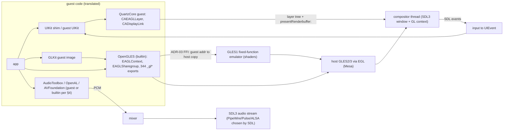

# 09 — Media: GLES, compositor, input, audio, video/images/fonts, networking, sensors

Decided by [ADR-11](02-decisions.md) (media and UI are native) and [ADR-03](02-decisions.md)
(pointer-width firewall). Guest GLES/CoreAudio are substituted at the dylib boundary; native
implementations live in `lib/media/` and `lib/builtins/`. Image names and VAs below were measured
from `work/10B329__iPad2,1/dyld_shared_cache_armv7` (569 images, [03-loader.md §2](03-loader.md))
with a throwaway Python walker over the image list, `LC_SYMTAB` and section tables; "present" means
present in that list or symbol table.

## 0. Data flow

## 1. Graphics: OpenGL ES 1.1 + 2.0

### 1.1 Measured: GL images in the cache

iOS 6 has a single `OpenGLES.framework`; there is **no** `libGLESv1_CM`, `libGLESv2` or `libEGL` image
(measured: no image path contains those names). Everything GL-related, with VA and `__text` size:

| Image (path under `/System/Library/`) | VA | `__text` | Role |
|---|---|---|---|
| `Frameworks/OpenGLES.framework/OpenGLES` | 0x325c8000 | 0x4f28 (20 KB) | public API: 344 `_gl*` exports (of 368 externs), `EAGLContext`, `EAGLSharegroup`, `_kEAGL*`; depends on `libGFXShared`, `IOKit`, `IOMobileFramebuffer`, `IOAccelerator`, `IOSurface` |
| `Frameworks/OpenGLES.framework/GLEngine.bundle/GLEngine` | 0x32506000 | 0xbd288 (775 KB) | the GL implementation bundle (224 `GL_*` tokens in `__cstring`, §1.2); loaded by OpenGLES via the path suffix `/GLEngine.bundle/GLEngine` found in OpenGLES's `__cstring`; depends on `libGFXShared`, `libCVMSPluginSupport`, `libGLImage`, `libGLProgrammability`, `IOKit`, `IOSurface` |
| `Extensions/IMGSGX543GLDriver.bundle/IMGSGX543GLDriver` | 0x30171000 | 0xeb670 | PowerVR SGX543 driver bundle (the hardware boundary; never run) |
| `Frameworks/OpenGLES.framework/libGLImage.dylib` | 0x325dd000 | 0x3d34c | texture/image helper (role `UNVERIFIED:` — name only) |
| `Frameworks/OpenGLES.framework/libGLProgrammability.dylib` | 0x3261b000 | 0x10c818 | shader compiler front end (`GL_OES_standard_derivatives` string present, §1.2); role `UNVERIFIED:` |
| `Frameworks/OpenGLES.framework/libLLVMContainer.dylib` | 0x32741000 | 0x4f8524 | embedded LLVM used by the programmability stack; role `UNVERIFIED:` |
| `Frameworks/OpenGLES.framework/libGFXShared.dylib`, `libCoreVMClient.dylib`, `libCVMSPluginSupport.dylib`, `libCoreFSCache.dylib`, `libCLRendererStubs.dylib` | 0x325d8000, 0x325d5000, 0x325d1000, 0x325d2000, 0x325d0000 | 0x323c, 0x19c4, 0x548, 0x1b60, 0xde | small support dylibs; roles `UNVERIFIED:` (names only) |
| `Frameworks/GLKit.framework/GLKit` | 0x31b8d000 | 0x1eed8 | guest framework layered on OpenGLES (runs as guest over our builtin) |

Consequences: (a) `GLEngine.bundle` **is** in the cache image list, at
`/System/Library/Frameworks/OpenGLES.framework/GLEngine.bundle/GLEngine`; (b) ADR-09 makes
`OpenGLES` + `GLEngine` + all `OpenGLES.framework/*.dylib` + `IMGSGX543GLDriver` **builtin**: guest code
never reaches the hardware driver, so `IOAccelerator`/`IOMobileFramebuffer` calls from those images
never happen (ADR-11: a guest that calls `IOConnectCallMethod` on `AppleS5L*` directly fails loudly).
Builtin entry VAs for cache images are the images' original export VAs ([03 §3.2](03-loader.md)).

GL entry points: `glBegin`/`glEnd` do **not** exist in OpenGL ES and are not exported by the cache's
OpenGLES (measured: `_glBegin` and `_glEnd` absent from its export list). Fixed-function ES 1.1 uses
client arrays plus `glDrawArrays`/`glDrawElements`; measured present: `_glVertexPointer`,
`_glDrawArrays`, `_glDrawElements`, `_glMatrixMode`, `_glPushMatrix`, `_glClientActiveTexture`
(ES 1.1) and `_glUseProgram`, `_glVertexAttribPointer` (ES 2.0), plus extension entry points
`_glBindVertexArrayOES`, `_glMapBufferOES`, `_glRenderbufferStorageMultisampleAPPLE`,
`_glResolveMultisampleFramebufferAPPLE`, `_glLabelObjectEXT`, `_glDiscardFramebufferEXT`
(38 `*OES`, 20 `*APPLE`, 47 `*EXT`, 0 `*IMG` exports). The builtin must export exactly this symbol set;
the loader's manifest is generated from the cache's export list, not hand-written.

### 1.2 PowerVR SGX543MP2 extension string (iPad2,1)

The GL string the device reports is produced at run time by the driver and is **not** measurable from
the cache. What is measurable: `GLEngine`'s `__cstring` contains 224 `GL_*` tokens (it carries
strings for every renderer family, so presence ≠ advertised on SGX543). Measured presence of each name
we plan to advertise (`data.find` over `__cstring`): `GL_OES_depth24`, `GL_OES_packed_depth_stencil`,
`GL_OES_rgb8_rgba8`, `GL_OES_standard_derivatives`, `GL_OES_texture_half_float`,
`GL_OES_vertex_array_object`, `GL_IMG_texture_compression_pvrtc`, `GL_APPLE_framebuffer_multisample`,
`GL_APPLE_rgb_422`, `GL_APPLE_texture_format_BGRA8888`, `GL_APPLE_vertex_array_object`,
`GL_EXT_texture_filter_anisotropic`, `GL_EXT_debug_label` — all present in GLEngine. `UNVERIFIED:` that
a real iPad 2 advertises exactly this set; close it with a device capture or a trace of the guest's
own `glGetString(GL_EXTENSIONS)` result under a reference run.

Advertising policy (decision): the string we return is the intersection of (this list) and (what the
host driver supports, queried at context creation), with these mappings:

| Advertised | Host mechanism |
|---|---|
| `GL_OES_vertex_array_object`, `GL_APPLE_vertex_array_object` | host GLES 3.0 VAOs (core in ES 3) |
| `GL_APPLE_framebuffer_multisample` | host GLES 3.0 `glBlitFramebuffer`/`glRenderbufferStorageMultisample` (present in `/usr/include/GLES3/gl3.h`) |
| `GL_OES_depth24`, `GL_OES_packed_depth_stencil`, `GL_OES_rgb8_rgba8`, `GL_OES_standard_derivatives`, `GL_OES_texture_half_float` | core in GLES 3 or widely exposed by Mesa; checked at startup |
| `GL_IMG_texture_compression_pvrtc` | `UNVERIFIED:` host support (Mesa does not expose PVRTC on desktop drivers); fallback = builtin software decode to RGBA8 at `glCompressedTexImage2D` time. Needs a PVRTC decoder (to be written; no host library verified) |
| `GL_APPLE_rgb_422`, `GL_APPLE_texture_format_BGRA8888` | converted on upload; BGRA via swizzle |

Host requirement: GLES 3.0 context (the host exposes `libGLESv2` 3.2, EGL 1.5 via libglvnd 1.7.0 with
Mesa 26.2.5 — `pkg-config --modversion glesv2 egl`). The guest still sees only ES 1.1/2.0 entry
points and versions strings (`OpenGL ES-CM 1.1`, `OpenGL ES 2.0 ...`).

### 1.3 Backend decision: native Mesa GLES vs ANGLE

**Decision: the host's native GLES (Mesa via libglvnd/EGL) behind our builtin OpenGLES; ANGLE is not
used.** ANGLE is not installed on the reference host (`pacman -Q angle libangle` → not found) and adds a
second translation layer (GLES→Vulkan/desktop GL) that Mesa's own GLES makes unnecessary. The claim in an
earlier draft that ANGLE's GLES1 path is incomplete is dropped (not verified).

- **GLES 1.1 fixed-function is always emulated** over GLES 2/3 shaders by the builtin: matrix stacks,
  `glVertexPointer`/`glColorPointer`/`glNormalPointer`/`glTexCoordPointer` client arrays, lighting,
  fog, texture environments, alpha test, user clip planes, point sprites. Host ES 1.x is *not* relied
  on: libglvnd ships `libGLESv1_CM.so.1` (145 `gl*` text symbols) as a dispatch stub, but whether Mesa
  provides an ES1 context behind it is `UNVERIFIED:` (the Mesa driver contains the string
  `"Incomplete OpenGL ES 1.0 support."`); experiment: `eglCreateContext` with
  `EGL_CONTEXT_CLIENT_VERSION=1` and `glGetString(GL_VERSION)`. Independent of that result the emulator
  is the plan, so behaviour does not depend on the host driver. This is the single largest media
  task. Prior art ([research/prior-art.md §2](../research/prior-art.md)): touchHLE offers either native
  GLES 1.1 or GLES1-on-GL2.1-compat backends; neither is a shader-based ES1 emulator over ES 2/3, so
  that part is ours to write.
- ES 2.0 calls forward 1:1 (after pointer/length translation, §1.4). The shader source is GLSL ES 1.00
  as written by the app; hosts accept it in a GLES 3 context (`#version 100` is valid there).
- Software fallback (llvmpipe) is whatever Mesa picks on the host.

### 1.4 EAGL and renderbuffer flow

Measured ObjC surface (from `__objc_classname`/`__objc_methname` and exports):

| Item | Where | Measured |
|---|---|---|
| `EAGLContext`, `EAGLSharegroup` | OpenGLES image | classes; exports `_OBJC_CLASS_$_EAGLContext`, `_OBJC_CLASS_$_EAGLSharegroup`; selectors `initWithAPI:`, `initWithAPI:sharegroup:`, `initWithAPI:properties:`, `initWithAPI:sharedWithCompute:`, `API`, `sharegroup`, `setCurrentContext:`, `currentContext`, `renderbufferStorage:fromDrawable:`, `presentRenderbuffer:`, `texImageIOSurface:target:internalFormat:width:height:format:type:plane:invert:`, `setDebugLabel:`, `drawableProperties` |
| `CAEAGLLayer`, protocol `EAGLDrawable` | **QuartzCore** (not UIKit, not OpenGLES) | classes `CAEAGLLayer`, `EAGLDrawable`, `CAEAGLLayerPrivate`; selectors `drawableProperties`, `setDrawableProperties:` |
| `kEAGLColorFormatRGB565`, `kEAGLColorFormatRGBA8`, `kEAGLDrawablePropertyColorFormat`, `kEAGLDrawablePropertyRetainedBacking`, `kEAGLContextPropertyAccelerated`, `kEAGLContextPropertyClientRetainRelease`, `kEAGLContextPropertySharegroup` | OpenGLES exports (data) | present |
| `EAGLGetVersion`, `EAGLMemoryNotificationRecycling`, `EAGLGetCurrentMacroContextPrivate`, `GLIContextFromEAGLContext` | OpenGLES exports | present; private/internal, stub-and-log |

(`EAGLView` is an app-side class, not a framework class: no such string in the cache.)

Because `OpenGLES` is builtin and libobjc is guest ([03 §3.2](03-loader.md), ADR-09), `EAGLContext` and
`EAGLSharegroup` are published as ObjC class metadata in the synthetic OpenGLES image whose IMPs are
builtin entry points; `CAEAGLLayer` stays guest code in QuartzCore (or is part of the compositor shim,
[08](08-frameworks.md)). `UNVERIFIED:` this mixed arrangement works end to end; see the experiment in
03 §3.2.

Flow:

- `EAGLContext` wraps a host EGL/GLES context. `renderbufferStorage:fromDrawable:` allocates a color
  renderbuffer sized to the `CAEAGLLayer` bounds×scale (drawableProperties select RGB565/RGBA8 and
  retained backing); `presentRenderbuffer:` hands the renderbuffer's contents to the compositor (§2).
- Guest `glDrawArrays`/`glDrawElements`: guest→builtin FFI per ADR-03. **Pointer arguments are guest
  addresses.** Policy for client-side vertex arrays:
  - Client arrays (no `GL_ARRAY_BUFFER` bound): at draw time copy the referenced range
    (`first..first+count`, or the index-derived min/max for `glDrawElements`, × stride) from the arena
    into a host streaming buffer and draw from it; cap 16 MiB per draw (larger → loud error, ADR-13).
    No pinning across frames, because guest memory is identity-mapped and may change between draws.
  - VBOs: `glBufferData`/`glBufferSubData` copy guest bytes into host buffers; `glMapBufferOES` returns
    a guest-arena shadow allocation that is copied back on `glUnmapBufferOES`.
  - Index arrays: copied likewise.
  - W^X (ADR-04) is irrelevant here: GL data never lives in the shadow region.
- Threading: GL calls from any guest thread are forwarded to the thread that owns the host context
  through a mutex + condition-variable queue, since one host context is current on one thread at a
  time. `UNVERIFIED:` per-guest-thread contexts (iOS allows several `EAGLContext`s current on different
  threads, e.g. a loader thread with a sharegroup); decision: one host context per guest context, all
  made current on the compositor thread via `eglMakeCurrent` hand-off, sharegroups map to EGL
  `share_context`.

### 1.5 IOSurface / CoreSurface replacement

Both are cache images, in **PrivateFrameworks** (not `IOSurface.framework`):
`/System/Library/PrivateFrameworks/IOSurface.framework/IOSurface` (0x34fad000, 226 exports incl.
`_IOSurfaceCreate`, `_IOSurfaceLock`, `_IOSurfaceUnlock`, `_IOSurfaceGetBaseAddress`, `_IOSurfaceLookup`,
`_IOSurfaceGetID`, `_IOSurfaceCreateMachPort`, `_IOSurfaceLookupFromMachPort`, many
`_IOSurfaceAccelerator*`) and `/System/Library/PrivateFrameworks/CoreSurface.framework/CoreSurface`
(0x34223000, 88 exports, `_CoreSurfaceAccelerator*`). Both are `builtin` (ADR-09, ADR-11) backed by
host shared memory (`memfd`) plus a handle/ID table; `IOSurfaceRef` is a guest-arena pointer to a small
struct. `IOSurfaceLock`/`Unlock` are no-ops over host memory; `IOSurfaceGetBaseAddress` returns the
guest-arena address of the backing store (so guest CoreGraphics can draw into it); `IOSurfaceAccelerator*`
blits are implemented in software. `UNVERIFIED:` which of the 226 exports real apps use; `stub`-mode
logging ([03 §3.3](03-loader.md)) drives the list.

## 2. Compositor & windowing

- Backend: **SDL3** (`pacman -Qi sdl3`: 3.4.18-1, licence **Zlib**; headers `/usr/include/SDL3`) for
  windowing, GL/EGL context creation, input and audio output. Chosen over winit because one dependency
  covers window + context + input + audio + text input. API names verified in the local headers:
  `SDL_GL_SetSwapInterval` (`SDL_video.h:3430`), `SDL_StartTextInput` (`SDL_keyboard.h:378`),
  `SDL_OpenAudioDeviceStream` (`SDL_audio.h`), touch events (`SDL_touch.h`, `SDL_events.h`).
- Frame pacing: `CADisplayLink` (class present in QuartzCore, measured) is driven by the compositor's
  frame clock: vsync via `SDL_GL_SetSwapInterval(1)`, else a `timerfd` at 60 Hz. Display-link callbacks
  run on the guest main thread via `CFRunLoop`. Deadline rule (decision): the compositor presents the most
  recently `presentRenderbuffer:`-ed frame at each vsync; if the guest misses a vsync the previous frame
  is shown again (no blocking of the compositor on the guest), and a guest that submits faster than 60 Hz
  has older frames dropped. `UNVERIFIED:` iOS's actual tearing/back-pressure behaviour in
  `presentRenderbuffer:`; irrelevant to correctness, relevant to feel.
- Geometry: iPad2,1 panel is 1024×768 at 132 ppi, scale 1.0 (non-Retina), status bar 20 pt (device
  specification, not measured here). Orientation by rotating the presented image; we present a
  1024×768 (or 768×1024) window scaled to the host monitor.

## 3. Input

- Touch: host mouse/trackpad/touchscreen → synthetic `UIEvent`/`UITouch` delivered to `UIApplication`.
  iOS 6 path is IOHID → backboardd → GSEvent mach message → UIApplication (platform lore, `UNVERIFIED:`
  locally); our shortcut builds the `UIEvent` directly and calls `-[UIApplication sendEvent:]`.
- Multitouch emulation: mouse = single touch; Shift+click = second touch; trackpad = native multitouch
  via SDL3 touch events; touchscreen = native.
- Accelerometer/gyro: `CoreMotion` (`CMMotionManager` present in the cache's CoreMotion) → fake device with
  configurable orientation; default gravity (0, −1, 0) in portrait. Apps that require motion (games) get
  a plausible static value.
- Keyboard: host keyboard → `UIKeyInput`/`UITextField` via SDL3 text input events.

## 4. Audio

Measured audio stack in the cache (VA, `__text`):

| Image | VA | `__text` | Notes |
|---|---|---|---|
| `Frameworks/AudioToolbox.framework/AudioToolbox` | 0x30b2f000 | 0x2401a4 | exports measured present: `_AudioQueueNewOutput`, `_AudioSessionInitialize`, `_AudioUnitInitialize`, `_AudioFileOpenURL`, `_ExtAudioFileOpenURL`, `_AudioServicesPlaySystemSound`, `_AudioConverterNew`; depends on `CoreAudio`, `CoreMedia`, `SpringBoardServices`, `Security`, `Accelerate`, `libMobileGestalt` |
| `Frameworks/AudioToolbox.framework/AudioCodecs` | 0x309f4000 | 0xcd53c | codec library (Apple software codecs, guest code) |
| `Frameworks/CoreAudio.framework/CoreAudio` | 0x30e7e000 | 0x4ef7c | HAL client |
| `Frameworks/OpenAL.framework/OpenAL` | 0x324e3000 | 0x1cfa8 | exports `_alcOpenDevice` + 95 more; depends on AudioToolbox |
| `Frameworks/AVFoundation.framework/AVFoundation` | 0x30284000 | 0xb82bc | classes `AVAudioPlayer`, `AVAudioSession`, `AVCaptureSession` present |
| `Frameworks/MediaToolbox.framework/MediaToolbox`, `PrivateFrameworks/Celestial.framework/Celestial` | 0x3217e000, 0x33daa000 | 0x22958c, 0xaf550 | CoreMedia-side playback/recording clients (role `UNVERIFIED:`) |

There is **no** `libAudioToolbox`, `AudioHAL`, or `mediaserverd` library image (`mediaserverd` is a
rootfs daemon, not in the cache). AudioToolbox's `__cstring` holds the Mach service names
`com.apple.audio.AudioQueueServer`, `com.apple.audio.AudioFileServer`, `com.apple.audio.AURemoteIOServer`,
`com.apple.audio.SystemSounds`, `com.apple.mediaserverd` (measured present as strings;
`UNVERIFIED:` that these are the `bootstrap_look_up` names), so audio runs through `mediaserverd` over
Mach IPC.

Decisions:

- **Cut point (ADR-08, ADR-11):** AudioToolbox, CoreAudio, AVFoundation, MediaToolbox stay **guest**; we
  implement the *services* natively (`com.apple.audio.AudioQueueServer`, `AURemoteIOServer`,
  `AudioFileServer`, `SystemSounds`, `mediaserverd` as in-process Mach services, [07](07-kernel-boundary.md)),
  so guest `AudioQueue`/`AudioUnit` buffers arrive as Mach messages/shared buffers and are mixed in
  process. Mach message formats are `UNVERIFIED:` — derive them from MIG stubs in AudioToolbox/Celestial
  (`mig` request/reply ids) before writing the services. `OpenAL.framework` is substituted by a builtin
  over **OpenAL-Soft** (`pacman -Qi openal`: 1.25.2, LGPL-2.0-or-later; headers `/usr/include/AL`), per
  ADR-11.
- **Backend:** one **SDL3 audio device stream** (`SDL_OpenAudioDeviceStream`) at 44.1 kHz stereo S16/F32;
  SDL3 selects PipeWire, PulseAudio or ALSA itself (`UNVERIFIED:` which on the user's host; the host
  here has `pipewire` 1.6.9, `libpulse` 17.0, `alsa-lib` 1.2.16).
- **Decoding:** guest `AudioCodecs` (Apple's own software decoders, guest code) is the default because it
  is bit-exact and has no external dependency; a native decoder is an optimisation selectable with
  `IOS6RECOMP_AUDIO_DECODER=native`. If the native path uses FFmpeg, note the licence: the host package
  is `ffmpeg 2:9.0.2-2` built **GPL-3.0-only** (`pacman -Qi ffmpeg`), not LGPL, so linking it into our
  binary has licence consequences; the plan is to `dlopen` it as an optional user-supplied plugin and
  never link or redistribute it (decision; verify the exact libs needed before implementing).

## 5. Video / images / fonts

- `ImageIO` (0x31d91000): guest. Software decoders in guest code; hardware JPEG via IOSurface
  accelerators is not available, so those calls (`_IOSurfaceAccelerator*`) hit §1.5's software blit.
  `UNVERIFIED:` which codec path ImageIO takes on iOS 6 without hardware; measure with stub logging.
- `CoreGraphics` (0x311d4000): guest, software rasteriser (Quartz 2D) plus `libCGFreetype`, `libRIP`,
  `libPDFRIP`, `libJBIG2` etc. (measured: `Frameworks/CoreGraphics.framework/Resources/*.dylib`). Perf
  concern for heavy drawing; acceptable for UI. `CGContext` bitmap backing is a guest-arena buffer,
  optionally wrapped in an `IOSurface`.
- `CoreText` (0x317d2000) + fonts: from the user's rootfs (`/System/Library/Fonts`,
  `/System/Library/Fonts/Cache`); `UNVERIFIED:` exact font and cache paths on 6.1.3 — list them with
  `7z l` on the decrypted rootfs image before M5. Font files are read via the 07 filesystem namespace.
- No Metal, no `VideoToolbox` hardware (`VideoToolbox` present at 0x334bd000 but needs
  `IOSurfaceAccelerator`/H.264 hardware). Video playback is out of scope for M5 (`stub`).

## 6. Networking

- `CFNetwork` (0x30db8000): guest, over our BSD sockets (07). HTTP/HTTPS, FTP, sockets functional.
- `SystemConfiguration` (0x32f26000, `_SCNetworkReachabilityCreateWithName` present): reachability is
  faked ("reachable" for any host); callbacks fire on the run loop.
- TLS: `Security` (0x32e79000) is guest; it needs entropy from `/dev/random` (07) and the `securityd`
  Mach service. Decision: implement `securityd`'s client-visible subset natively (certificate
  verification via the host TLS library, keychain in a file under the container). Crypto primitives
  may call the host via FFI for RSA/AES for performance. `UNVERIFIED:` the securityd message set.

## 7. Power / sensors / location / camera

Explicit stubs with loud logging (ADR-13). Services that must return plausible values to avoid hangs:

- `IOKit` power: return `kIOReturnSuccess` and a fake battery (100 %, charging).
- `CoreLocation` (`CLLocationManager` present): return a fixed location or "not authorized"; never block.
- `AVCaptureSession` (present in AVFoundation)/camera: return "no camera" error, do not hang waiting for frames.
- `CMMotionManager`: return static gravity.
- `UIDevice` battery: 1.0, `UIDeviceBatteryStateCharging`.

## 8. Verification

- Tie to M5 exit: one real app launches, renders, accepts touch, runs 60 s at ≥ 15 fps (the M5 gate
  in `11-milestones.md`; this is a minimum, not the 60 fps vsync target of §2), no unhandled
  fault/abort in strict mode.
- Export-set test: the builtin OpenGLES's symbol list equals the cache's OpenGLES export list
  (`llvm-nm`-style comparison against the measured 344 `_gl*` + EAGL symbols); `glBegin`/`glEnd` absent.
- GLES fixture app (self-built, armv7 Mach-O, ADR-14) renders a triangle (ES 2.0) and a textured quad
  through ES 1.1 fixed-function client arrays; `qemu-arm` is not applicable (no GPU), so verification
  is structural: framebuffer CRC compared to a golden image generated by the same code path on a
  reference run, plus an extension-string test (§1.2 intersection rule).
- EAGL test: fixture creates `EAGLContext initWithAPI:` for both API values, makes it current, binds
  `renderbufferStorage:fromDrawable:` on a `CAEAGLLayer`, and `presentRenderbuffer:`s; asserts the
  compositor received a frame of the layer's size.
- Touch: automated injection of a tap sequence; assert the app's `touchesBegan:` was called with the
  right coordinates (via a test hook in the shim).
- Audio: render a 440 Hz sine for 1 s through `AudioQueueNewOutput`; assert the output buffer's FFT
  peak at 440 Hz ± 2 Hz.
- Visual verification: screenshot diff against golden frames **if** the user provides them (from real
  hardware); otherwise structural tests only (layer tree, renderbuffer contents, no crashes). Golden
  frames are never committed to the repo (README input contract).
