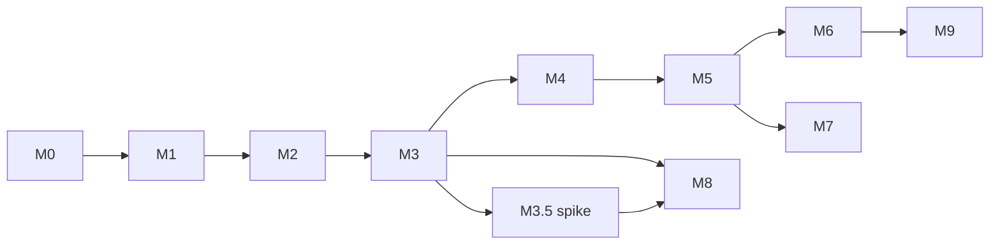

# 11 — Milestones

---

## Implementation status (2026-10-18)

Measured, not planned. Everything below was exercised against a real iOS 6.1 (10B329) root
filesystem and its `dyld_shared_cache_armv7` (569 images, 203 MiB, mapped at `0x3000_0000`).

| Capability | Evidence |
|---|---|
| Mach-O load + dyld-info rebase/bind | `/sbin/fsck` runs natively through OrcJIT: `fsck -h` prints usage and exits 22; bare `fsck` prints `Can't open checklist file: /etc/fstab` and exits 8 — identical to the interpreter |
| ARMv7/Thumb-2 lifting | arithmetic/logic/shifts, `ldm/stm`, `ldrd/strd`, `ldrex/strex`, `umull/smull/smmul`, `sxtb/sxth/uxtb/uxth`, `tbb/tbh`, `mrc/mcr` (TPIDRURW), `svc`, conditional `bx`, predicated memory operands, shifted index operands |
| Host libc trampolines | 76 symbols behind `svc`-based trampolines, name-driven via `HOST_FUNCTIONS`/`builtin_for` |
| Export-trie symbol resolution | `link-check` resolves **67/67** imports of `iOS Diagnostics.app`; `cache-exports` lists a dylib's whole trie |
| Bind-ordinal semantics | per-image ordinals count `LC_LOAD_UPWARD_DYLIB` (the cache rewrites deps that way), ordinal `0` resolves against the image's own exports, and `STUB_AND_RESOLVER` exports bind to their resolver (binding `_memcpy` to its own stub used to recurse forever) |
| Shared-cache execution | cache mappings copied into the arena, 111 images bound in dependency order, guest code from libobjc/libsystem_c runs in the JIT (`objc_msgSend`, `pthread_*`) |
| dyld-equivalent process setup | 16 image initializers run in dependency order; `_NSGetArgc/Argv/Environ/`MachExecuteHeader``, TPIDRURW, commpage, NEON d0–d31, emulated default `malloc_zone_t` |
| Startup syscalls | `SYS_ioctl` (37) and `SYS_thread_selfid` (423) answered; startup no longer enters the `ENOSYS` path |
| dyld image API | `_dyld_image_count`, `_dyld_get_image_header`, `_dyld_get_image_name` and `_dyld_get_image_vmaddr_slide` served from an emulated table seeded with the app plus all 569 cache images |
| Guest fault reporting | `IOS6_TRACE=1` traces blocks; `IOS6_WATCH=<addr>` names the block that wrote a word; host SIGSEGV/SIGBUS is reported with the guest PC and faulting address |

**Not yet:** a full app run. All 16 initializers complete and the app's entry point executes.
libobjc's own registration now runs: `__objc_init` requests dyld services by name through
`_dyld_func_lookup`; `__dyld_dyld_register_image_state_change_handler` is served, and its
`map_images`-style handler (state 40, batch) runs with all 112 bound images. The handler
completes, but libobjc's class table (`gdb_objc_realized_classes`) is still NULL, so
`objc_getClass`-style lookups fault at `0x38fc1734`.

Two suspects, both verified to exist, neither yet ruled in or out:
- Imports bound through `STUB_AND_RESOLVER` exports land on the resolver address (`link.rs`), not
  on the resolved target. Any libc entry called from `map_images` may be broken this way.
- 13 `HOST_FUNCTIONS` names (`_stat`, `_open`, `_strdup`, ...) have no arm. They now log
  `unimplemented host function` when called, but none is called on this path, so they are
  ruled out for this fault.

Fixed this round: `_bcopy` was mis-bound (libobjc's `NXMapTable` key copy); it is now a host
builtin, which made `NXCreateHashTable` succeed. `_memcpy` is also a host builtin now.

Also unhandled: BSD syscall `#339` (`r0=2`), reached from startup; not yet identified.

dyld is not in the shared cache, and cache words that point into it are now handled explicitly.
Cache data holds one word that references dyld's `__TEXT` (`Rewrote 1 ...` in the run log): `_dyld_func_lookup` (`0x2fe01008`, reached
through libdyld's function table) is redirected to a host trampoline (`__dyld_func_lookup`), which
answers names from the host symbol table. The cache file is already slid, so no slide fixups are
applied. (Measured: 2,359,770 slide-info-marked words, none in the dyld range.)

Platform pieces now emulated because real code demanded them: commpage at `0xffff_0000` (zeroed,
so probes take slow paths), NEON d0–d31 at `0x2100_9000`, `TPIDRURW`, `_NSGetArgc/Argv/Environ`,
`dmb/dsb/isb`, `ldrex/strex`, a 4 KiB code window, a predication-safe scratch page at
`0x2201_0000` (predicated loads/stores must not fault when their condition is false), and a guest
`malloc_zone_t` whose function pointers are zone-ABI host trampolines.

Next steps, in order:

1. Find why `map_images` (state-40 handler, `0x38fc0189`) returns without populating the class
   table: trace its calls to imports and check each import's bound target.
2. Fix the stub-and-resolver binding. `link.rs` currently binds a `STUB_AND_RESOLVER` export to its
   resolver's address, which is wrong: the resolver must be *called* to obtain the target. Once the
   binder can run guest code, resolve these through the resolver.
3. Identify BSD syscall `#339` and answer it with the value userland expects.
4. Run ObjC image registration (`__objc_imageinfo`, class lists) before `main`.

Reproduce:
Reproduce:

```bash
R=~/.cache/dmgref/BrightonMaps10B329.K93OS
C=$R/System/Library/Caches/com.apple.dyld/dyld_shared_cache_armv7
cargo run -p ios6-cli -- link-check "$R/Applications/iOS Diagnostics.app/iOS Diagnostics" --cache "$C"
cargo run -p ios6-cli -- run-app   "$R/Applications/iOS Diagnostics.app/iOS Diagnostics" --cache "$C"
IOS6_TRACE=1 cargo run -p ios6-cli -- run-app "$R/Applications/iOS Diagnostics.app/iOS Diagnostics" --cache "$C"
```

---

Each milestone has a **measurable** exit criterion. "It works" is not a criterion. Effort is in
engineer-weeks for one experienced engineer; the numbers are planning inputs, overturnable by
evidence, not commitments. Critical path to "a real app renders" (M0→M1→M2→M3→M4→M5; M3.5 runs
alongside M4): 1+3+3+4+4+6 = **21 w** best case, 2+4+4+6+8+12 = **36 w** worst case (M3.5's 1 w is off
that path). [13-risks.md R-16](13-risks.md) uses these numbers.

Two rules that make this sequence work:

1. **Every milestone can be demoed with no Apple binaries present.** The fixture set
   (`fixtures/`, built by clang for `armv7-apple-ios6` from sources in `tests/fixtures/`) is the
   regression spine. Real iOS 6 binaries are an *integration* input, not a development input
   ([ADR-12](02-decisions.md)).
2. **Each milestone's exit criterion is a number**, so "done" is not a matter of opinion.

| # | Milestone | Effort | Depends on |
|---|---|---|---|
| M0 | Skeleton, IPSW/cache forensics, CI | 1–2 w | — |
| M1 | Mach-O loader, arena, fixture toolchain (incl. `ios6recomp-ld`) | 3–4 w | M0 |
| M2 | Decode + discovery + interpreter tier | 3–4 w | M1 |
| M3 | Lifter + ORC JIT tier | 4–6 w | M2 |
| M3.5 | ADR-04 spike (shadow region vs block table) | 1 w | M3 (first working JIT on the block-table path) |
| M4 | Real `libobjc` + CoreFoundation + Mach IPC minimum | 4–8 w | M3 |
| M5 | First real app: GLES + UIKit shim + compositor | 6–12 w | M4 |
| M6 | Compatibility hardening across apps | ongoing | M5 |
| M7 | Performance | 4–8 w | M5 |
| M8 | AOT / shipping mode, persistent cache | 3–5 w | M3, M3.5 |
| M9 | Stretch: guest daemons, arm64 host, more apps | — | M6 |



---

## M0 — Skeleton and forensics (1–2 w)

Deliverables: CMake+Ninja project with the component layout of `01-architecture.md`; a CLI
(`ios6recomp`) with `--version`; `ctest` wired; CI building with clang 23 and running the unit tests;
`lib/macho` minimally able to read a `dyld_cache_header` and a 32-bit Mach-O header; `scripts/prepare-inputs.sh`
([10-build-tooling.md §4](10-build-tooling.md)) producing the two inputs below.

Commands that must exist and work:

```
ios6recomp ipsw list <file.ipsw>        # roles from BuildManifest.plist (OS, KernelCache, RestoreRamDisk, ...)
ios6recomp cache info <dyld_shared_cache>  # header fields, arch, image count, dylib list, subcache presence
ios6recomp macho info <path>            # header, cputype/cpusubtype, load commands, encryption info
```

**Exit:** on the local iPad2,1 6.1.3 IPSW, `ipsw list` prints `OS`, `KernelCache`,
`RestoreRamDisk` and their filenames; inputs are produced with the patched ipsw, no root:
`ipsw extract --dyld --lookup -o work <ipsw>` gives `dyld_shared_cache_armv7` (246,791,518 B,
sha1 `8a9d9587d0bc91871458d50bce71682eb341d26a`) and `ipsw extract --kernel --lookup` gives the
armv7 kernel Mach-O (13,987,840 B including 57 trailing zero bytes, sha1
`3a65ceeba525af4e0959ffcf7b45edc9c6fd8a74`; measured 2026-10-17 with a freshly built `ipsw`, [10-build-tooling.md §4](10-build-tooling.md))
— see [03-loader.md §6](03-loader.md); `cache info` prints the mapping-derived shared region
start/end (0x30000000 / end of mapping 3), image count (569), `dyldBaseAddress` (0x2fe00000), header
size 0x58 and magic `dyld_v1   armv7`; `macho info` on
a fixture reports `cputype=12 cpusubtype=9` (armv7); CI is green and under 10 minutes.

**Falsifies:** all platform-shape assumptions. ADR-02's free low arena was checked here with a 10-line
program (`/tmp/aud/m.c`): `mmap(0, 4 GiB, … MAP_FIXED_NOREPLACE)` fails `EPERM`, `mmap(mmap_min_addr = 65536,
4 GiB − 65536, …)` succeeds at `0x10000`. The `ios6recomp` startup check (`guestmem` arena reserve) must
reproduce exactly that and print the failing range on error; test: run it under `ulimit -v 4000000`
and under a non-PIE host binary linked at `0x400000`, both must fail with a message naming the cause.

---

## M1 — Loader, arena, fixtures (3–4 w)

Deliverables: `macho` complete for our needs (segments, sections, `LC_DYLD_INFO_ONLY`, export trie,
symbol table, `LC_FUNCTION_STARTS`, `LC_DATA_IN_CODE`, `LC_ENCRYPTION_INFO`, fat binaries);
`guestmem` arena with reserve/map/protect; `loader` mapping a multi-image set with rebase/bind;
`ios6recomp-ld` ([ADR-14](02-decisions.md)): the minimal Mach-O linker that turns clang's
`armv7-apple-ios6.0`/`armv7s-apple-ios6.0` objects into runnable fixtures (`ld64.lld` cannot link
32-bit ARM); an ELF twin built with `--target=armv7-linux-gnueabi -mfloat-abi=soft` and `ld.lld
-m armelf_linux_eabi` for the `qemu-arm` oracle ([12-testing.md §2](12-testing.md)).

**Exit:**
- `ios6recomp macho info` agrees with `llvm-objdump --macho --private-headers --exports-trie --rebase --bind
  --lazy-bind --data-in-code` (all options exist in the local `llvm-objdump`) on every fixture and
  on a real dylib extracted from the shared cache (field-by-field, no hand-waving).
- `ios6recomp map app` shows every segment at its guest `vmaddr` with correct protections, and
  `/proc/self/maps` confirms guest VA == host VA for all of them. Images whose `vmaddr` is below
  `vm.mmap_min_addr` (the real apps: `__PAGEZERO` 0x1000, `__TEXT` 0x1000) are covered by two fixtures
  made with `ios6recomp-ld`: with `MH_PIE` it loads slid to ≥ 0x10000, without it it is refused with a message naming
  `vm.mmap_min_addr` ([ADR-02](02-decisions.md)).
- An image with `cryptid=1` is rejected with `E_ENCRYPTED_BINARY` (fixture: flip the bit).
- ≥ 12 fixtures exist, covering: integer ALU + flags, all ARM condition codes, IT blocks of every
  mask, BL/BLX/BX/BXJ/table-switch, `ldr/str` all addressing modes, unaligned access, `ldrd/strd`,
  `ldm/stm` with writeback (and the 16-bit Thumb `ldm` with the base in the list, [04 §7](04-translation.md)), alignment faults
  for `ldm`/`ldrd`/`vldr`, VFP arithmetic/comparison/convert, NEON
  3-same/2-reg/lane/table-lookup, `svc`, TSD access via `TPIDRURO`, `setjmp/longjmp`, soft-float
  varargs and a struct-returning call (`sret`).

**Falsifies:** the loader model, the identity mapping, and the fixture strategy.

---

## M2 — Decode, discovery, interpreter (3–4 w)

Deliverables: LLVM-MC-backed decoder with a Capstone cross-check
([ADR-07](02-decisions.md)); block discovery; the semantic table format with rows covering ≥ 85 % of the static
instruction count of `__TEXT` over all 569 cache images (`IOS6RECOMP_LIFT_STATS`) and all T1 rows of
[04 §5](04-translation.md); the tier-0 interpreter; `GuestThreadContext`; the minimum
kernel shim needed to run a fixture (`exit`, `write`, `mmap`, `read`).

**Exit:**
- **Decode differential:** decoding all `__TEXT` of ≥ 50 real dylibs from the shared cache produces
  zero decode *errors*, and the LLVM-MC↔Capstone disagreement rate is < 0.01 % of instructions with
  every disagreement on a written allow-list.
- **Execution differential:** every fixture produces byte-identical stdout and identical exit status
  under tier 0 and under `qemu-arm` running the ELF build of the same source.
- **Instruction fuzz:** the per-instruction state-diff harness (`12-testing.md` §Fuzzing) shows 100 %
  register/flag/memory agreement with the reference oracle (`qemu-arm -cpu max`) on all implemented opcodes, over ≥ 10⁷
  random instruction streams, excluding the encodings the ARM ARM marks UNPREDICTABLE (e.g. ARM `ldm rN!,{…rN…}` raises
  SIGILL under QEMU; [04 §7](04-translation.md)), which are listed and counted separately.
- `IOS6RECOMP_LIFT_STATS` reports the missing-opcode table for real framework code, and that table is
  the work list for M3.

---

## M3 — Lifter and JIT (4–6 w)

Deliverables: IR emission from the semantic table; one LLVM function per block under a deterministic
symbol scheme; ORC `LLJIT` + `JITLink` integration behind the `BlockTable` interface ([05-jit.md §1](05-jit.md)) with the
a trivial hash-map implementation first (neither ADR-04 candidate; the shadow-region memory manager or the page table is built once M3.5 locks ADR-04);
block linking; interpreter fallback for missing opcodes; `IOS6RECOMP_TIER=jit|interp`.

**Exit:**
- **Tier agreement:** all fixtures and the fuzz corpus produce identical results under tier 0 and
  tier 1, including cpsr/fpscr at every block boundary.
- A fixture that uses our own mini-libc (`printf` → `write`, `malloc` → `mmap`) runs end-to-end
  through the JIT.
- CoreMark (or Dhrystone) compiled as an armv7 Mach-O fixture, also compiled for x86-64 natively and
  for armv7-ELF: record three numbers (native x86-64, `qemu-arm`, ours).
- Block invalidation works: a fixture that writes to its own code page and re-executes takes the
  `Invalidated → Discovered` path (assert via stats).

---

## M3.5 — ADR-04 spike (1 w, starts when M3's first JIT runs; parallel with M4)

Measurements to report, appended to [ADR-04](02-decisions.md), that either lock the shadow region or
switch to the block table:

1. Distribution of x86-64 bytes per ARMv7 block over ≥ 10⁴ blocks from real code, per instruction
   class (ALU / load-store / branch / VFP / NEON). Pick `E` as the smallest member of {6, 8, 10} with
   `2^E ≥ p99.9` of host bytes per block, subject to measurement 2.
2. Fraction of block starts whose relocation is a spill-stub under `E` ∈ {6, 8, 10} (slot = 64 B / 256 B / 1 KiB; reservation is `2^(32+E)` B = 256 GiB / 1 TiB / 4 TiB; all three were already
   accepted by this host's kernel, [ADR-04](02-decisions.md)); the decision rule is [14-open-questions.md Q-01](14-open-questions.md): spill rate < 5 %.
3. Indirect-transfer rate: dynamic indirect transfers as a fraction of dynamic instructions, on
   CoreMark + a UIKit-ish fixture.
4. Cold-start cost: blocks materialised per second and per fault vs. per explicit lookup call.
5. Whether a custom `JITLinkMemoryManager` can sub-allocate and `mprotect` inside the shadow region
   with acceptable finalisation cost (measured, not argued).

**Exit:** a written decision with the five numbers and ≥ 10⁴-block data, plus the loser's prototype
deleted or explicitly parked.

---

## M4 — Real `libobjc` + CoreFoundation (4–8 w)

Deliverables: the guest's own `libsystem_c` malloc zones and `libsystem_kernel` stubs running over
the kernel shim ([07](07-kernel-boundary.md)); guest `libobjc` (keeping its own `objc_msgSend`, JIT'd well,
[08 §2](08-frameworks.md)); enough of the kernel shim for CF and Foundation initialisation; Mach IPC
minimum (`mach_msg`, port rights, `bootstrap_port`, `mach_absolute_time` (the r12 = -3 fast path),
semaphores, `thread_switch`); `CFRunLoop` able to run.

**Exit:** a fixture linking against the user's real `libobjc.A.dylib` + `CoreFoundation` from the
shared cache runs and prints correct results for: `NSMutableArray` add/enumerate, `NSString`
formatting (including `%@`), a category method, a subclass with `super` calls, `NSInvocation`,
`objc_msgSend_stret`, ARC-style retain/release traffic, an autorelease pool, `NSDictionary` JSON
round-trip via `NSJSONSerialization`, and a `CFRunLoop` timer callback. The stub-hit and
missing-opcode tables for this fixture are published and tracked as the compatibility burn-down.

**Risks exercised here:** R-01 (`objc_msgSend` ABI), R-03 (unwinding), R-05 (Mach IPC fidelity).

---

## M5 — First real app (6–12 w)

Deliverables: minimal UIKit shim (`UIApplication`, `UIWindow`, `UIView`, `CALayer` stub, `EAGLView`,
`UIEvent`/touch, `NSTimer`/`CADisplayLink`), OpenGL ES 1.1/2.0 through native Mesa GLES ([09 §1.3](09-media.md)), a compositor, input, minimum
CoreAudio, a `CFRunLoop` driven from the compositor's frame clock.

**Exit:** one real user-supplied decrypted armv7 app launches, renders, accepts touch, and runs 60 s
at ≥ 15 fps without an unhandled fault or an abort in strict mode. Published: the app's stub/missing
tables, the fps distribution, and the list of substituted dylibs.

---

## M6 — Compatibility hardening

Driven by data, not by guesses: bucket every failure by the first stub hit or missing opcode, fix in
descending order of apps-unblocked. **Exit:** 5 apps of different genres (GLES game, UIKit utility,
2D engine, OpenAL audio app, web-wrapper) run to a usable state, with zero unknown-opcode hits across
all of them; a compatibility matrix is published in `docs/compat.md` (generated, with the app names
redacted to hash IDs since we do not ship them).

---

## M7 — Performance (4–8 w)

Ordered by expected payoff, to be re-ordered by the M3 profile: (1) flags — lazy/deferred
flag materialisation ([04-translation.md §6](04-translation.md); the expected gain is UNVERIFIED there); (2) register
allocation-friendly IR (fewer GTC spills, SSA values for guest registers inside a region);
(3) region/superblock compilation instead of per-basic-block; (4) inline caches for indirect
transfers; (5) persistent block cache ([ADR-10](02-decisions.md)).

**Exit:** on the CoreMark/Dhrystone/GLES fixture set, ≥ 3× the `qemu-arm` number from M3, and ≥ 30 %
of the native x86-64 number on at least one workload (targets, not forecasts: if M3's three recorded
numbers already put the ratios outside that range, re-derive the thresholds from them before starting M7);
time-to-first-`main()` of the Foundation fixture ≤ 5 s and time-to-first-frame of the M5 app ≤ 30 s with a
warm persistent cache (the R-02 trigger thresholds, [13-risks.md](13-risks.md)).
Publish per-benchmark numbers with the tier-0 number for scale.

---

## M8 — AOT and persistent cache (3–5 w)

**Exit:** `ios6recomp build app.ipa -o app.ios6` produces a translated image linked with `lld`; the
app runs with JIT disabled (`IOS6RECOMP_TIER=aot`) and with W^X enforced (no RWX anywhere in the
process's own mappings); a re-run with the persistent cache performs zero lifting before first frame
(asserted via stats).

---

## M9 — Stretch

Guest daemons as real processes over Unix-socket `mach_msg` (ADR-08's deferred half); arm64 Linux
host (the translator's IR is already host-neutral — this is mostly a JITLink backend and memory-manager
exercise); more apps; iOS 7+ gated on 64-bit support, which is a separate project.

---

## First two weeks, concretely

1. `CMakeLists.txt`, `lib/macho/CMakeLists.txt`, `tools/ios6recomp/CMakeLists.txt`, CI workflow.
   LLVM discovery: `find_package(LLVM 23.1 CONFIG REQUIRED)` (major.minor is exact; a broken
   24.0.0git LLVM sits in `/usr/local`), link the shared `LLVM` target only — per-component
   archives like `LLVMARMDisassembler` do not exist here and `llvm_map_components_to_libnames`
   fails. Proven CMakeLists and smoke tests: [10-build-tooling.md](10-build-tooling.md).
2. `ipsw list` — `BuildManifest.plist` parsing (C++ has no plist parser in-tree; vendor a minimal
   XML-plist reader, ~200 lines).
3. `cache info` — the dyld-212 cache header. This proves or breaks the plan's platform model. The
   input is produced by `ipsw extract --dyld --lookup` (patched ipsw, no root: [03-loader.md §6](03-loader.md),
   [10-build-tooling.md](10-build-tooling.md)); the header is 88 bytes, not the dyld-239 layout
   ([research/ios6-platform.md §5](../research/ios6-platform.md)).
4. ADR-02's arena reservation proof (done, result in M0 above): reserve `[mmap_min_addr, 4 GiB)` and print
   the matching `/proc/self/maps` line (measured: `00010000-100000000 ---p`).
